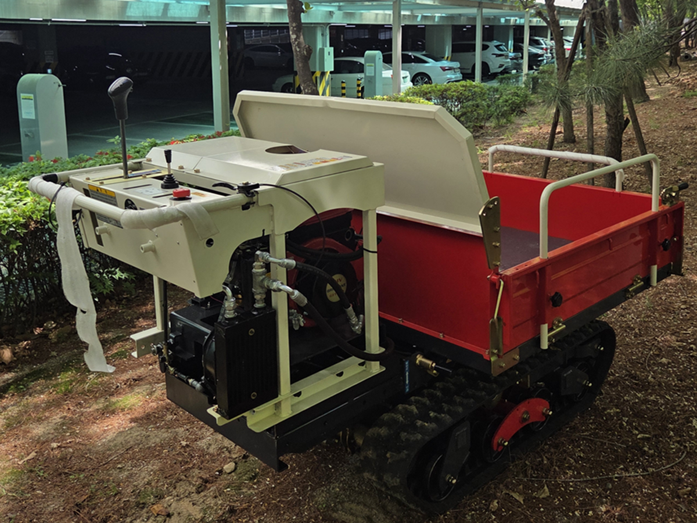
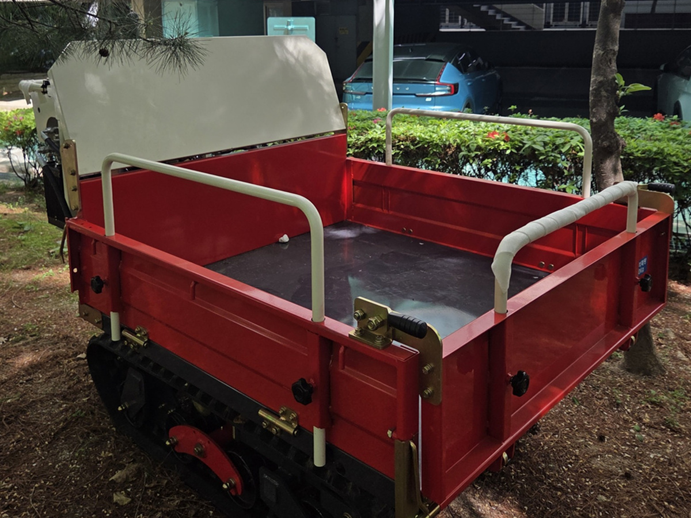
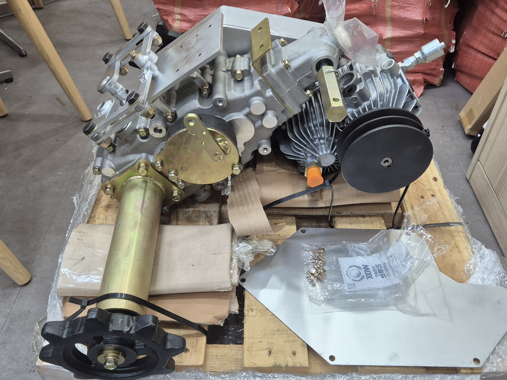
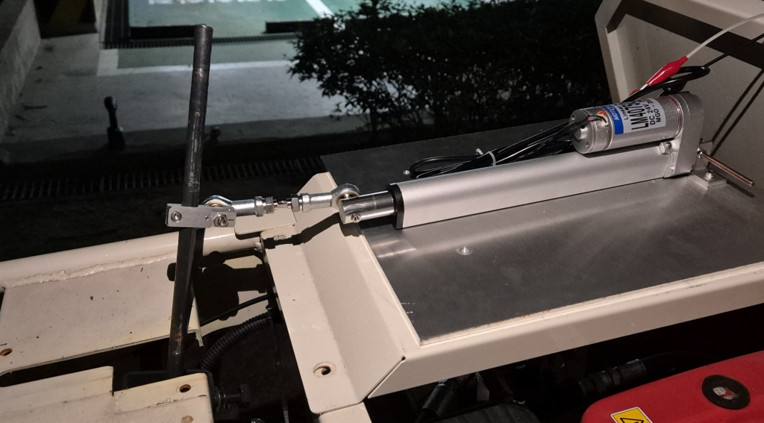
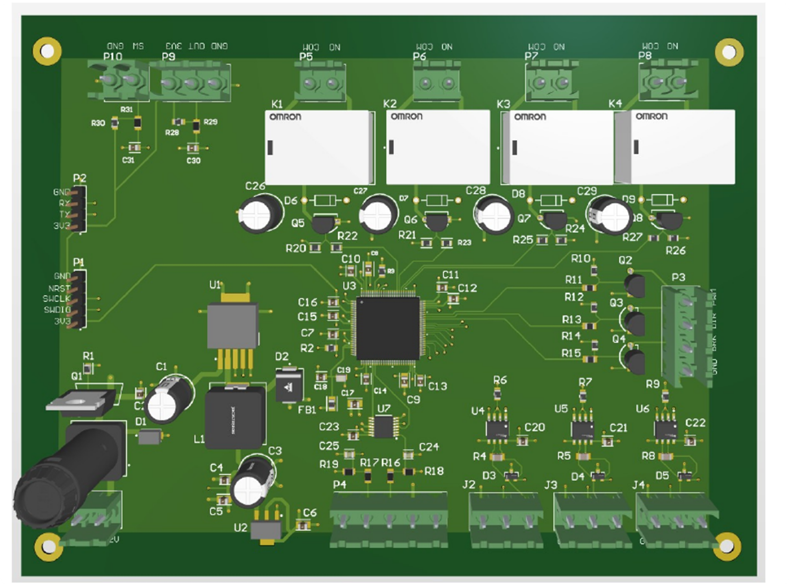
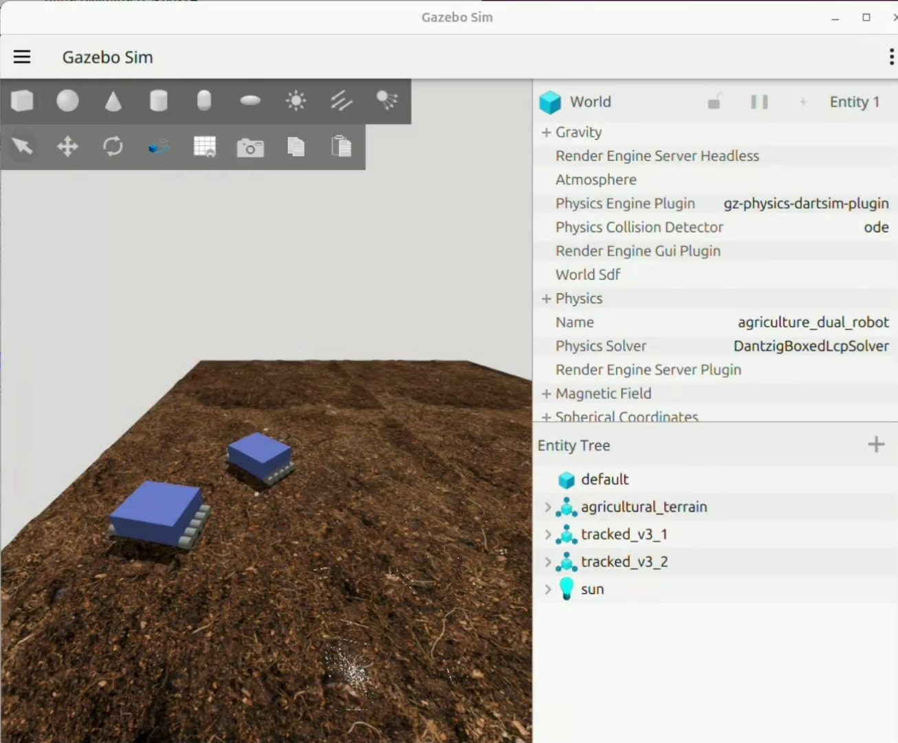

# Agricultural Vehicle Leader–Follower Control System

## Overview

This project focuses on developing a leader–follower control system for a hydraulically driven agricultural vehicle in collaboration with Duru Machinery. The work includes mechanical and electrical system analysis, lever-actuation mechanism design, STM32-based control hardware, and ROS 2/Gazebo simulation.

## Agricultural Vehicle

  
  

## Mechanical & Electrical System Analysis

Analyzed the hydrostatic transmission (HST), the mechanical linkage connecting the travel lever to the HST control input, and the vehicle's existing electrical control signals.

- Measured actuation torque at the travel lever and HST-side control input, and examined forward/reverse lever operation.
- Characterized voltage levels and signal states associated with engine starting and steering.
- Compared candidate actuation points while considering mechanical characteristics and installation constraints.

## Actuator & Linkage Design

Selected lever-side actuation to preserve the original mechanical linkage and support removable installation.

- Estimated actuator thrust requirements based on the measured peak lever force and linkage geometry.
- Selected a linear actuator and designed a linkage assembly to meet the actuation requirements.
- Installed the actuator linkage and verified actuator-driven lever movement with the engine off.

## STM32 Control Hardware

Designed and assembled a four-layer STM32-based control PCB to meet the identified automation requirements.

- RS-485 communication interfaces
- Relay-based steering control
- Motor driver interface for travel-lever actuator control
- Encoder interface for actuator position feedback

## ROS 2 / Gazebo Simulation

Adapted existing UWB-based leader–follower control code and evaluated vehicle tracking behavior across simulated turning scenarios in ROS 2/Gazebo.

## My Contributions

- Analyzed the HST drive mechanism and electrical control signals, and measured actuation torque to select an appropriate actuation point.
- Developed the lever-actuation mechanism and designed and assembled the STM32-based main control PCB.
- Adapted existing leader–follower control code and evaluated tracking behavior in ROS 2/Gazebo.
